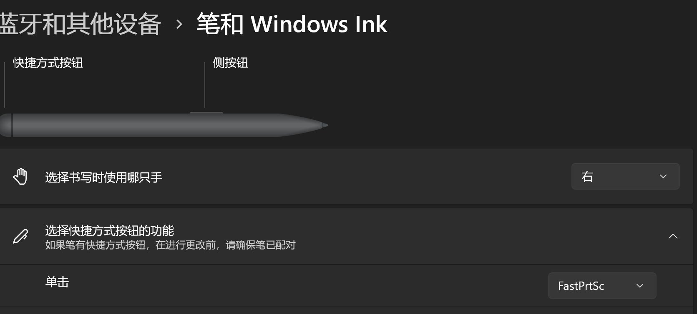

# Fast_PrtSc 快截屏

- 受够了Win10那**一样的截图功能？
- 就算是Win11最少也要两步。
- 我只是想快速截屏！！！
- `Fast_PrtSc`将此程序绑定在你的 *键盘宏、鼠标宏、甚至是Windows手写笔* 上！
- 立马截屏！然后结束！只需要一步！

## 特性

- 无任何冗余GUI，双击即截屏的截图工具。截图完成后立即退出程序，并在屏幕右下角弹出短暂的消息弹窗。
- 一键截屏当前状态，自动适配 DPI 缩放的真实物理分辨率
- 截图保存为 PNG，文件名带时间戳（`Screen_yyyyMMdd_HHmmssfff.png`），默认保存在根目录
- 通过 `config.json` 配置保存路径与文件名前缀，无需重新编译

## 如何绑定
- 为你的手写笔`快捷方式按钮`设定`打开程序`并指向该应用
<div align="center">
  
</div>

## 配置

编辑程序同目录下的 `config.json`（缺失或损坏时回退默认根目录）：

```json
{
  "SavePath": "",
  "FileNamePrefix": "Screen"
}
```

| 字段 | 说明 |
| --- | --- |
| `SavePath` | 保存目录。留空为 exe 所在目录；相对路径基于 exe 目录解析；支持 `~` 表示用户主目录；路径中的单反斜杠会被自动修正 |
| `FileNamePrefix` | 文件名前缀，默认为 `Screen` |

## 许可证

[MIT](LICENSE)
